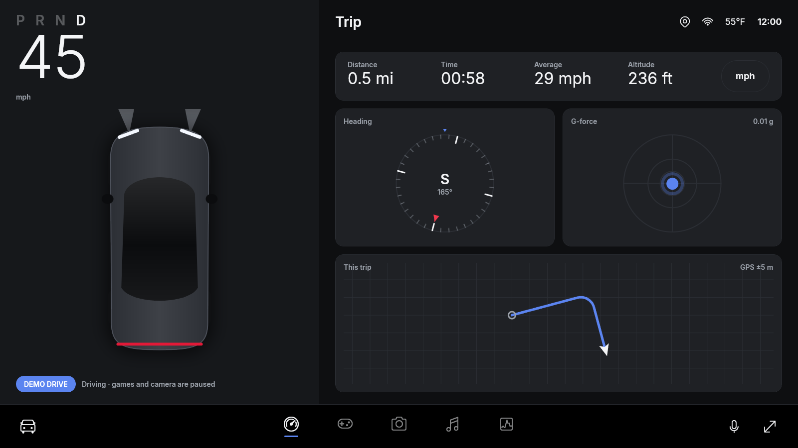
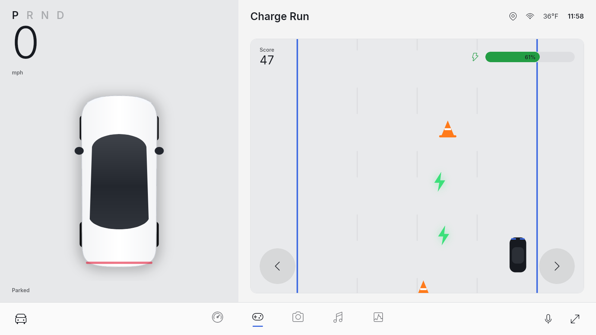
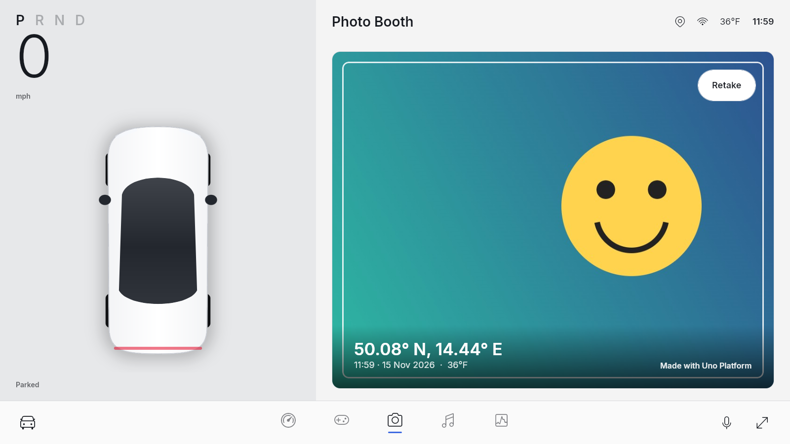
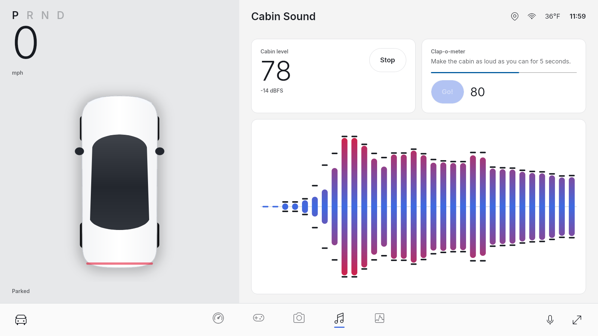
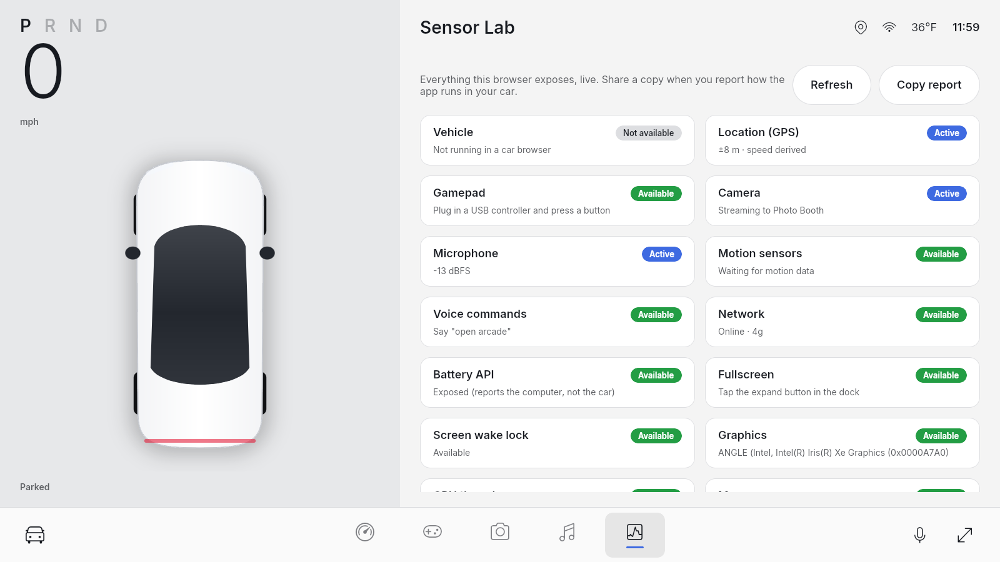

# Uno Cockpit 🚗

An [Uno Platform](https://platform.uno) 7.0 WebAssembly app that turns your car's touchscreen browser into a sensor-powered cockpit. It's written in C# and XAML, rendered with Skia, and talks to the browser's sensors through Uno's WinRT APIs and a small JavaScript bridge.

**Try it in your car:** `martinzikmund.github.io/UnoCockpit`



> Not affiliated with or endorsed by Tesla, Inc. The app is built for the in-car browser and follows its general look; all artwork is original.

## What's inside

| Mini-app | What it does | Sensors |
|---|---|---|
| **Trip** | Speed, heading compass, G-force circle, distance/time/average, altitude, and the path you've driven | GPS (speed and heading reported or derived), motion sensors when present |
| **Charge Run** | An original top-down arcade game: grab charge bolts, dodge cones, don't run flat | USB gamepad, keyboard, touch, Web Audio through the car speakers |
| **Photo Booth** | Cabin selfie with a 3-2-1 countdown, turned into a postcard stamped with where you are, the time and the outside temperature | Camera, GPS, weather |
| **Cabin Sound** | Live microphone spectrum and the 5-second Clap-o-meter challenge | Microphone (Web Audio analyser) |
| **Sensor Lab** | Every capability the browser exposes, with live values and a "copy report" button | All of the above, plus network, fullscreen, wake lock, WebGL, CPU, memory |

Around them:
- The car render's **headlights** come on after dark.
- The **theme** switches light/dark at local sunrise and sunset, computed from GPS.
- **Weather** comes from [Open-Meteo](https://open-meteo.com) (keyless).
- **Voice commands** ("open arcade") work where the browser supports speech recognition.
- **Fullscreen** is one tap away.

| | |
|---|---|
|  |  |
|  |  |

### Safety first

Charge Run, Photo Booth and Cabin Sound only work while the car is **parked**: GPS speed has to stay under 2 km/h for 5 s. The moment you drive off they pause and release the camera and microphone. Only the glanceable Trip view stays on while moving. There are no lap timers, 0–60 runs or top-speed brags.

### Demo mode

No GPS? If location is denied or unavailable (say, on your laptop), the app plays a recorded demo drive, so everything still moves. You can also turn it on from the car menu in the dock.

## Sensor matrix

| Sensor | Used by | API | Notes |
|---|---|---|---|
| GPS | Trip, theme, weather, postcard, parking | JS `getCurrentPosition`, polled at 1 Hz (`?geo=uno` switches to Uno's `Geolocator`) | `watchPosition` has a history of failing in the car browser |
| Gamepad | Charge Run | Uno `Windows.Gaming.Input.Gamepad` | USB controllers; press a button to wake it |
| Camera | Photo Booth | `getUserMedia` into a native `<video>` hosted by Uno's `BrowserHtmlElement` | Parked, AMD Ryzen cars, software 2026.26+ |
| Microphone | Cabin Sound | `getUserMedia` + Web Audio `AnalyserNode` | Same requirements as the camera |
| Motion | Trip G-forces | `devicemotion` | Used only when real data arrives; otherwise G-forces are derived from GPS |
| Speech | Voice commands | Web Speech API | Button only appears when supported. Chromium's recognizer sends audio to an online speech service, so it only listens after you tap the mic |
| Audio out | Game sound effects | Web Audio oscillators | No audio files shipped |
| Network, fullscreen, wake lock, WebGL, CPU, memory | Sensor Lab, status bar | Browser APIs | |

## How it's built

```
UnoCockpit.Core/        plain net10.0: all logic + view models (CommunityToolkit.Mvvm), unit tested
  Geo/ Motion/ Sun/       trip math, G-force estimator, park detector, NOAA sunrise/sunset
  Game/ Demo/ Sensors/    game rules, demo drive, sensor contracts, browser JSON parsing
  ViewModels/             one per mini-app + the shell
UnoCockpit.Core.Tests/  MSTest, ~115 tests
UnoCockpit/             Uno single project (browserwasm + desktop), Skia renderer
  Services/SensorHub      polls sensors, feeds view models (1 Hz + per-frame only when needed)
  Sensors/Browser/        thin [JSImport] wrappers
  Platforms/WebAssembly/WasmScripts/cockpit.js   the whole JS bridge, one section per sensor
  Views/                  XAML views + SKCanvasElement drawings (car, gauges, game, spectrum)
```

Design and plan: [`docs/superpowers/specs`](docs/superpowers/specs) and [`docs/superpowers/plans`](docs/superpowers/plans).

## Run it locally

Requirements: .NET 10 SDK and the `wasm-tools` workload (`dotnet workload install wasm-tools`).

```bash
dotnet test UnoCockpit.Core.Tests
dotnet run --project UnoCockpit -f net10.0-browserwasm   # http://localhost:5000
dotnet run --project UnoCockpit -f net10.0-desktop       # demo drive, keyboard controls
```

Keyboard: ← → (or A/D) steer, Space starts the game.

## Download size

See [`docs/measurements.md`](docs/measurements.md). Most of the first load is the .NET runtime, Uno's UI assemblies and ICU data for Skia text. GitHub Pages serves gzip only.

## Tell me how it runs in your car

Open **Sensor Lab**, tap **Copy report**, and [open a car report](../../issues/new?template=car-report.yml). Model, year and software version help a lot.

## License

MIT, see [LICENSE](LICENSE). Third-party notices in [THIRD-PARTY-NOTICES.md](THIRD-PARTY-NOTICES.md).
